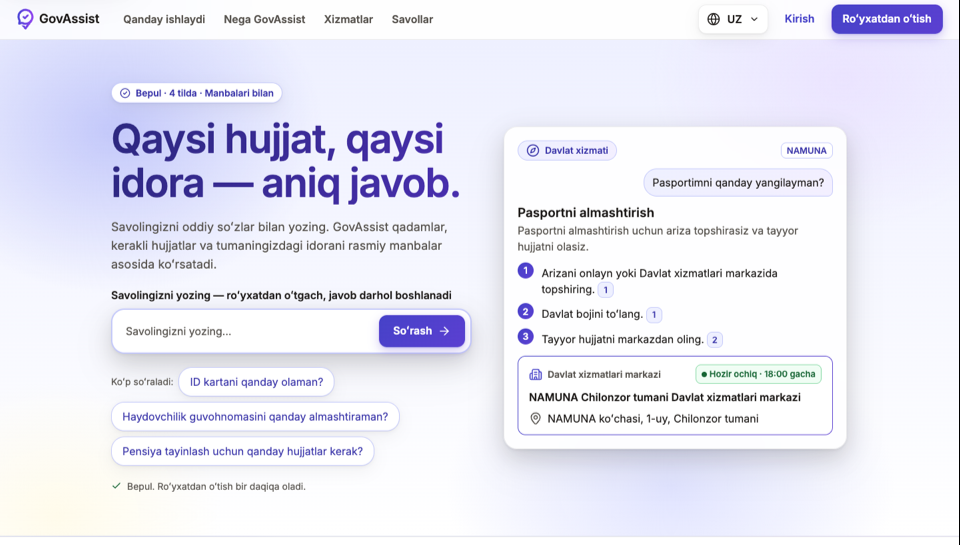
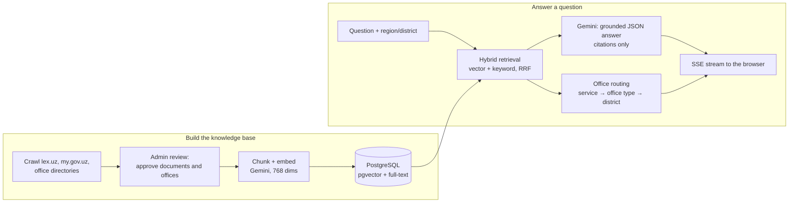

# GovAssist

**An AI assistant that tells citizens of Uzbekistan how to get a public service, with sources and the right office in their district.**

[](https://github.com/mashkhurbek-mashrabov/govassist/actions/workflows/backend.yml)
[](https://github.com/mashkhurbek-mashrabov/govassist/actions/workflows/frontend.yml)

**Live:** [gov.ilmsoft.uz](https://gov.ilmsoft.uz)



GovAssist is the practical part of the MSc thesis *"Development of an Intelligent Assistant for Navigating Government and Public Services Based on Retrieval-Augmented Generation Technology"* (ITPU / EPAM, 2026).

> GovAssist is an independent student project. It is **not** an official government service, and its answers are not legal advice.

## Why

People still queue at government offices, and they often go to the **wrong one**. The rules are spread across legal texts ([lex.uz](https://lex.uz)), the service portal ([my.gov.uz](https://my.gov.uz)) and office pages. General chatbots can invent fees and deadlines, don't cite official sources, and don't know which office in your district handles your request.

## What it does

A signed-in user picks a region and district, then asks a question in plain language, for example *"Pasportimni qanday yangilayman?"* ("How do I renew my passport?"). The answer:

- is a **step-by-step card** (summary, steps, documents, fee, processing time) built **only** from a reviewed corpus;
- cites every claim, with numbered links to the lex.uz article or my.gov.uz page;
- shows the **exact office in the user's district**: name, address, hours, phone and map link;
- **streams** while it is written;
- **refuses honestly** when the corpus doesn't cover the question.

The app works in **Uzbek (Latin and Cyrillic), Russian and English**.

## How it works



1. **Collect.** A polite crawler (robots.txt per RFC 9309, about 1 request/second per host, stops on HTTP 403/429) fetches pages. Gemini extracts office records, and an admin approves every document and office before use.
2. **Index.** Approved text is chunked and embedded (`gemini-embedding-2`, 768 dimensions) into pgvector, alongside Postgres full-text search over script-normalised text.
3. **Retrieve.** Vector and keyword results are fused with reciprocal rank fusion, and Uzbek Latin/Cyrillic spelling is normalised.
4. **Generate.** Gemini answers in a strict JSON schema, using only the retrieved passages, with citations. The browser parses the partial JSON and fills the cards live. A final, validated answer replaces the live one.
5. **Route.** The retrieved service maps to an office type, and the office card comes from the database, never from the model.

The SSE event order is `meta → status → office → delta… → final → done`. See [`docs/contract.md`](docs/contract.md).

## Tech stack

| Layer | Technology |
|---|---|
| Backend | Python 3.14, Django 6.1, DRF, drf-spectacular, django-allauth (headless: email + Google), django-unfold admin |
| Data | PostgreSQL 18 + pgvector (HNSW, cosine), Postgres full-text search, Redis 8 |
| Jobs | `django.tasks` with the database backend (`db_worker`): crawling and indexing |
| LLM | Google Gemini (`google-genai`): generation and embeddings |
| Frontend | React 19, Vite 8, TypeScript, React Router, TanStack Query, react-hook-form + zod, react-i18next, Tailwind 4 |
| Quality | pytest (97.6% coverage), ruff, mypy `--strict`; Vitest, Playwright + axe; GitHub Actions |
| Ops | Docker (multi-stage, non-root), Docker Compose, nginx, Cloudflare Turnstile, Brevo SMTP |

## Repository layout

```
backend/     Django project: apps accounts, geo, offices, corpus, retrieval, chat, collector, evaluation
frontend/    React SPA + nginx image that serves it and proxies the API on one origin
deploy/      Example config for a host's reverse proxy
docs/        Plans, API contract, design system, schemas, data sources
tasks.py     invoke tasks (Docker, database, data, quality)
compose*.yaml  Docker Compose: base, dev overrides, production
```

## Quick start (local)

Requirements: Docker with Compose, Python 3 (for `invoke`), and a Gemini API key.

```bash
git clone https://github.com/mashkhurbek-mashrabov/govassist.git
cd govassist
cp .env.example .env              # then set GEMINI_API_KEY (and Google OAuth keys if you want Google login)
python3 -m venv .venv && .venv/bin/pip install -r backend/requirements/dev.txt
source .venv/bin/activate

invoke up                         # build and start db, redis, backend, worker and web
invoke seed                       # regions/districts (SOATO), office types, sample crawl sources
invoke createsuperuser            # admin user
```

Open http://localhost:8080 for the app and `http://localhost:8080/<ADMIN_URL>` for the admin. In development, verification emails are printed to the backend log (`invoke logs --service backend`).

To build a corpus, add or approve sources in the admin, then:

```bash
invoke crawl --source "<source id or name>"
invoke index                      # embed every approved document that has no chunks yet
```

### Common tasks

| Command | What it does |
|---|---|
| `invoke up` / `invoke down` | Start / stop the stack (data volumes are kept) |
| `invoke logs [--service backend]` | Follow logs |
| `invoke migrate` / `invoke makemigrations` | Database migrations |
| `invoke check` | Backend lint + mypy `--strict` + tests (needs `invoke up`) |
| `invoke schema` | Regenerate `docs/schema/` from the code |
| `invoke backup` | Dump the database to `backup.sql.gz` |
| `cd frontend && npm ci && npm run dev:mock` | Frontend alone on mocks (MSW), no backend |
| `npm run lint && npm run typecheck && npm test` | Frontend checks |

## Production

```bash
docker compose -f compose.yaml -f compose.prod.yaml up -d
```

- Only the `web` (nginx) container publishes a port: `WEB_PUBLISH`, default `127.0.0.1:8015`. The database, Redis, backend and worker stay on the private Docker network.
- A reverse proxy in front terminates TLS and forwards to it. See [`deploy/nginx/govassist.conf`](deploy/nginx/govassist.conf), which also covers Nginx Proxy Manager.
- Set `DJANGO_SETTINGS_MODULE=config.settings.prod`, `ALLOWED_HOSTS`, `CSRF_TRUSTED_ORIGINS`, `FRONTEND_URL`, a real `EMAIL_URL` (SMTP) and real Turnstile keys in `.env`. `.env.example` documents every variable.

## Evaluation (thesis)

The `evaluation` app compares GovAssist with baselines on a versioned question set:

- **RQ1:** RAG vs the same model without retrieval.
- **RQ2:** GovAssist vs ChatGPT, Gemini and Claude with simple and expert prompts, especially on office routing and citation validity.
- **RQ3:** vector vs keyword vs hybrid retrieval, with and without Uzbek script normalisation.
- **RQ4:** a small user study.

Metrics: Recall@5, MRR, citation validity, office routing accuracy, refusal accuracy, script consistency, latency and cost. Answers are graded by an LLM judge from a **different vendor** than the generator, plus blind human grading (Cohen's κ).

```bash
invoke manage --cmd "load_eval_questions --file questions.jsonl --version v1"
invoke manage --cmd "run_eval --name hybrid-v3 --mode hybrid --normalize on --rag on --prompt v3"
invoke manage --cmd "compare_runs hybrid-v3 keyword-v3"
```

Results are written only by these scripts to `docs/results/`. The framework is built and the experiments are in progress, so no results are published yet.

## Data and ethics

- Every corpus source is recorded with its URL, publisher, terms and fetch date in [`docs/corpus-sources.md`](docs/corpus-sources.md).
- The crawler respects robots.txt and rate limits, uses an honest User-Agent, and stops for good when a site blocks it.
- Personal data (passport numbers, PINFL, phones, emails) is scrubbed before storage, embedding, LLM calls and logs.
- Model output and crawled text are rendered as plain text, never as HTML.

## Documentation

| Document | What it is |
|---|---|
| [`docs/plans/00-main-plan.md`](docs/plans/00-main-plan.md) | Goals, fixed decisions, architecture, research design |
| [`docs/contract.md`](docs/contract.md) | API, SSE stream and Answer schema: the source of truth between backend and frontend |
| [`docs/design/`](docs/design/) | Design system, tokens, screens, clickable journeys and screenshots |
| [`AGENTS.md`](AGENTS.md) | Contributor and AI-agent rules: lanes, testing, code standards, security |
| [`backend/AGENTS.md`](backend/AGENTS.md), [`frontend/README.md`](frontend/README.md) | Stack-specific notes |

## Author

**Mashkhurbek Mashrabov**, MSc student, ITPU (EPAM). Scientific advisor: Serhii Semenov. Technical mentor: Taras Ustyianovych.
